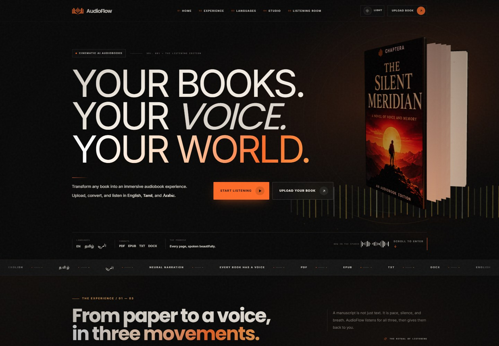
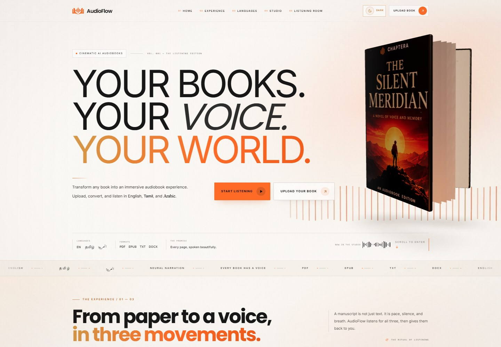
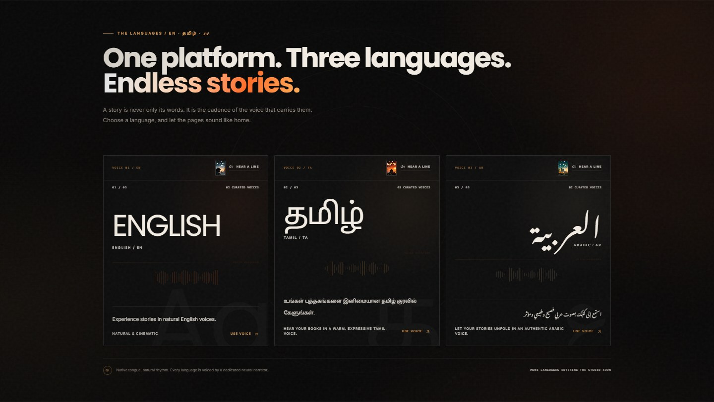
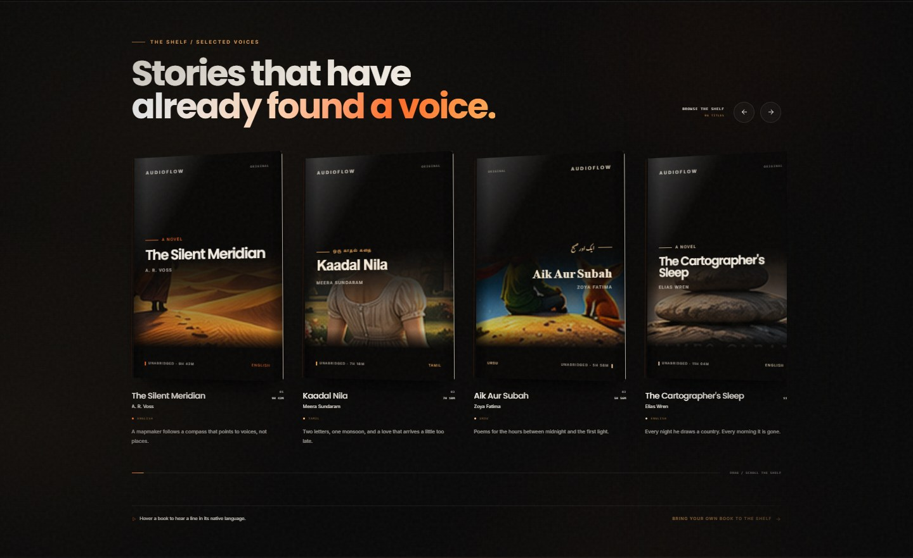
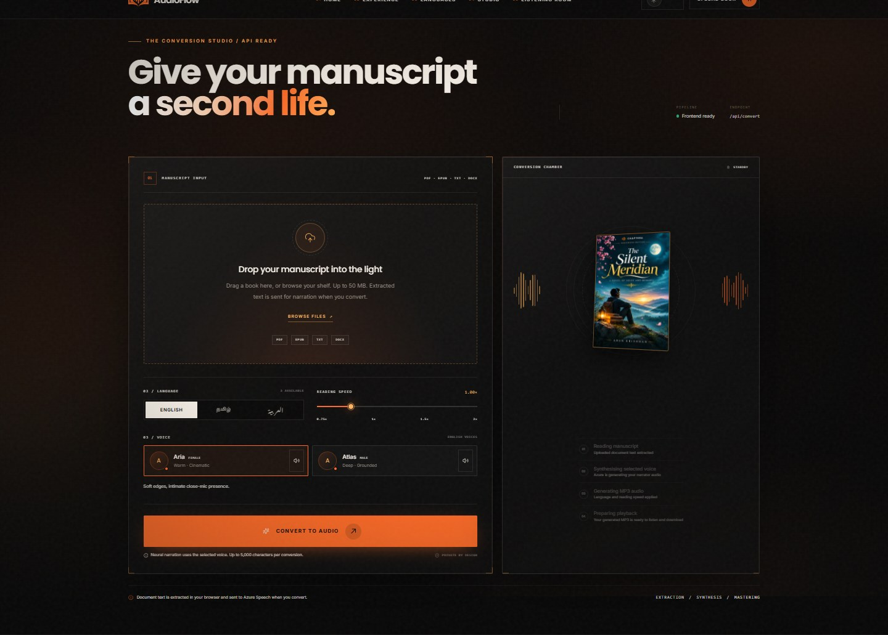
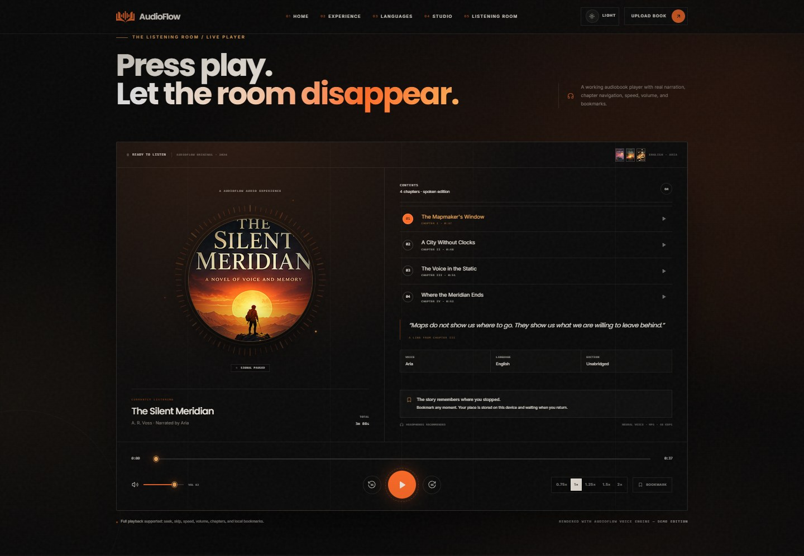
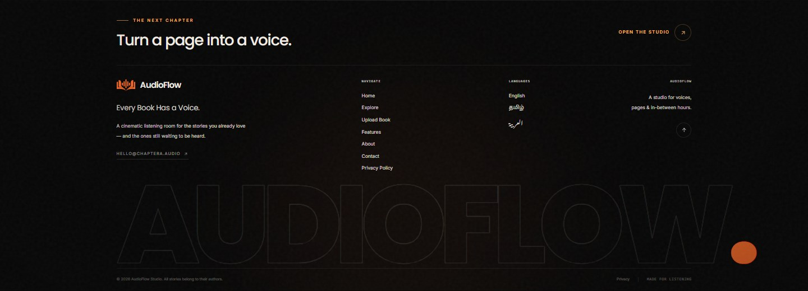

# AudioFlow

**Every Book Has a Voice.**

AudioFlow is a responsive audiobook landing page built with React, Vite, Tailwind CSS, Three.js, GSAP, and Framer Motion. A cinematic 3D book, language previews, an interactive listening room, and an animated bookshelf introduce the audiobook experience.

This repository contains the landing page and its existing demo narration API. The separate audiobook dashboard and software are maintained outside this repository.

## Current design

### Dark theme

The page opens in dark mode with AudioFlow branding, orange accents, and a 3D book hero.



### Light theme

The header theme button switches to warm ivory. Your preference is saved in the browser.



### Languages

The current interface presents English, Tamil, and Arabic with native scripts and voice selection.



### Featured bookshelf

Illustrated covers, perspective effects, and local audio previews.



### Studio preview

Document upload, voice selection, and reading-speed controls. Document conversion requires the narration API described below.



### Listening room

Chapter selection, play/pause, seeking, volume, playback speed, and bookmarks saved in the browser.



### Closing section



## Run locally

Use Node.js 22.13 or later.

```bash
npm ci
npm run dev
```

Open `http://127.0.0.1:5173`, or the address printed by Vite.

To build and preview:

```bash
npm run build
npm run preview
```

## Connect the separate audiobook software

Set `VITE_AUDIOBOOK_APP_URL` before building to point the Studio navigation and upload calls to action to your separately deployed software:

```env
VITE_AUDIOBOOK_APP_URL=https://your-audiobook-app.example/#audiobook
```

During Vite development, these links default to `http://localhost:3000/#audiobook`. Production builds without this setting scroll to the embedded `#studio` section. The separate audiobook software is not included in this repository.

## Demo audio and narration

The listening room, bookshelf previews, and voice auditions use checked-in MP3 files under `public/audio`. Sample playback works without Azure credentials.

The interface now displays Arabic, but the Arabic-labelled previews still reuse the older Urdu MP3 assets. The bundled Node API maps English, Tamil, and the original Urdu narrators; it does not yet map the new Arabic narrator IDs. Arabic document conversion requires a compatible external audiobook service or a future API update.

For supported English and Tamil voices, the embedded Studio extracts PDF, TXT, DOCX, or EPUB text and posts up to 5,000 characters to `/api/convert`. The Node API calls Azure Speech and returns MP3 audio.

Configure these server environment variables to use that API:

```env
AZURE_SPEECH_KEY=your-speech-resource-key
AZURE_SPEECH_REGION=your-speech-resource-region
```

Then run:

```bash
npm run build
npm start
```

Open `http://localhost:10000`. The server serves the built page and API together and uses `PORT` when provided. Vite development proxies `/api` to port 10000.

Keep credentials in the server environment. The Node entry point does not load a `.env` file automatically. Static hosting supports the page and samples; embedded document conversion needs the Node API. The demo API permits two simultaneous conversions and 30 requests per hour per server process. Scanned PDFs need OCR before conversion.

## Project structure

```text
src/
  components/          landing sections, 3D hero, Studio, and player
  hooks/               shared audio preview logic
  lib/                 content, document extraction, API, and Studio links
  index.css            themes, responsive layout, and animation styles
public/
  audio/               chapter audio and preview samples
  assets/books/        self-hosted cover artwork
  audioflow-mark.svg   AudioFlow brand mark
server/                existing Node narration API and production server
docs/                  current README screenshots
scripts/               optional voice asset generation
```

The page includes mobile layouts, keyboard controls, focus styles, a skip link, and reduced-motion support. Some internal asset names and browser storage keys retain the earlier Chaptera name for compatibility.
