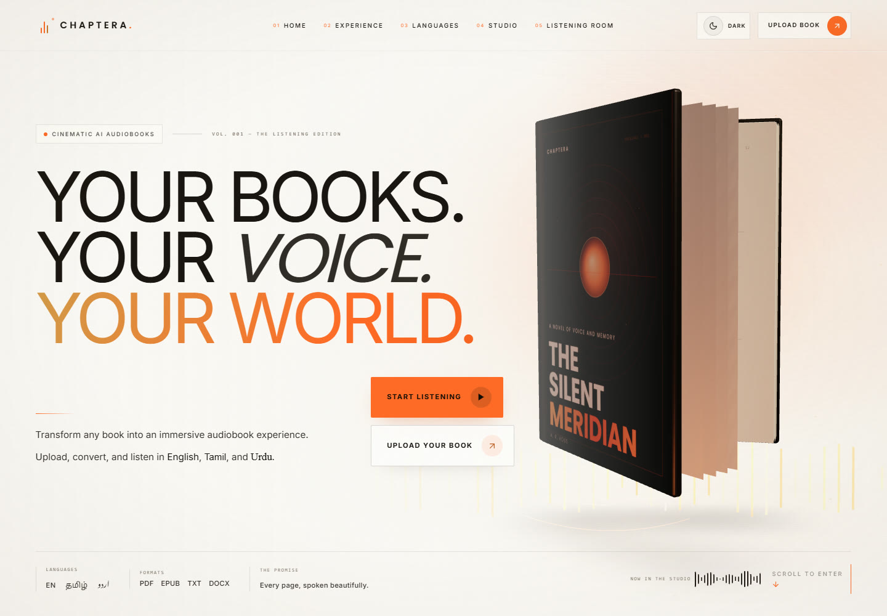
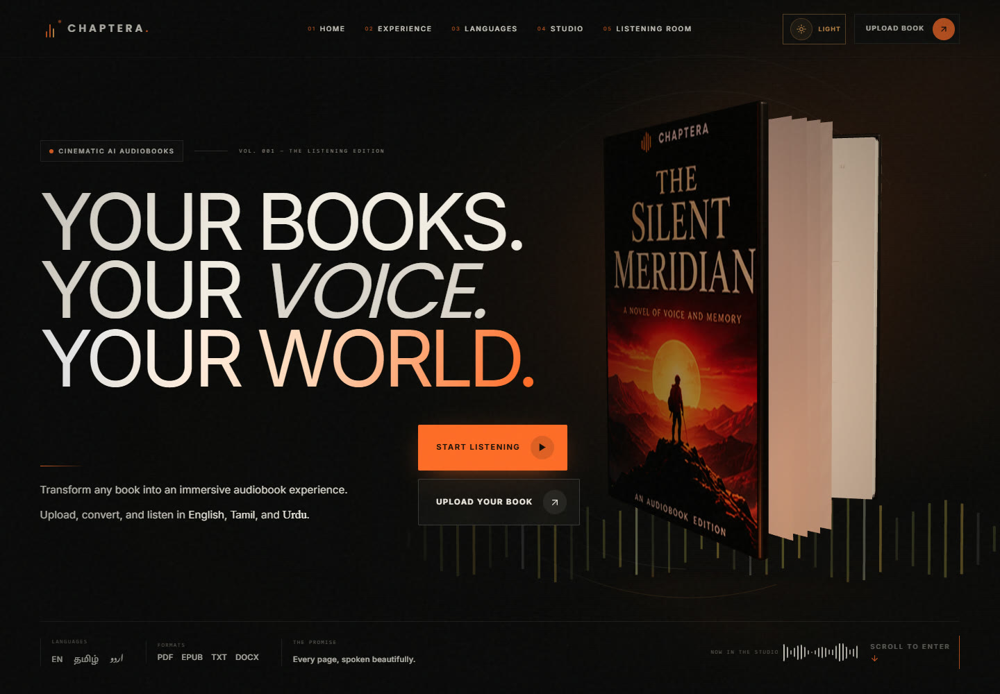
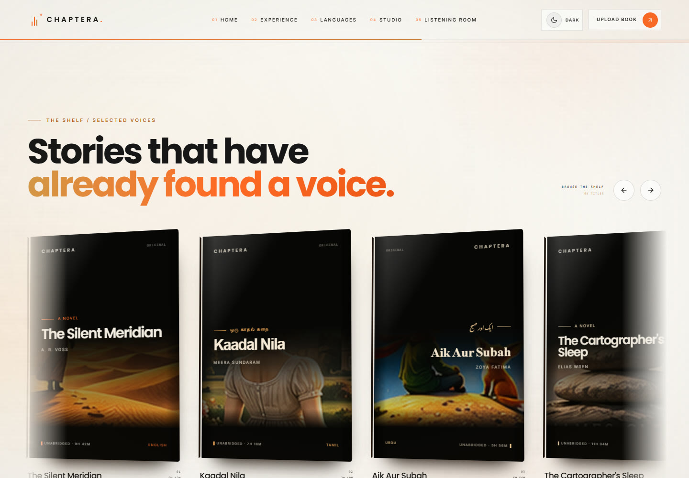

# Chaptera

**Every Book Has a Voice.**

Chaptera is a cinematic, 3D audiobook experience built with React, Vite, Tailwind CSS, Three.js, React Three Fiber, GSAP, Framer Motion, and Lucide. It pairs a premium editorial interface with a working local audiobook player and a conversion studio that is ready to connect to a real text-to-speech backend.



The header moon/sun control switches between the warm ivory atmosphere and the original dark cinematic mood. The choice is saved in the browser.





Premium cover artwork is self-hosted in `public/assets/books` and mapped to the 3D hero, featured shelf, language cards, workflow visuals, and listening room.

## Run locally

```bash
npm install
npm run dev
```

Open the URL printed by Vite (normally `http://localhost:5173`).

```bash
npm run build
npm run preview
```

## What is included

- **Cinematic 3D hero** — a procedural hardcover book with cover textures, page flips, shadows, ember particles, orbital sound rings, and mouse/scroll camera movement.
- **Three-part storytelling section** — custom 3D CSS scenes for upload, voice synthesis, and listening, with mouse tilt and scroll reveals.
- **Language experience** — English, Tamil, and Urdu cards with native typography, RTL Urdu, animated waveforms, and real neural voice samples.
- **Conversion studio** — drag-and-drop upload, format validation, language and male/female voice selection, reading-speed control, animated conversion stages, a neural voice preview, and a working sample download.
- **Audiobook player** — real chapter audio, play/pause, ±15 seconds, volume, five playback speeds, chapter navigation, bookmarks stored locally, circular audio analyser, and progress controls.
- **3D featured shelf** — horizontally scrollable/draggable book covers with perspective tilt, hover glow, and a spoken line for every title.
- **Why Chaptera** — seven animated 3D feature vignettes instead of stock icon cards.
- **Scroll-closing finale** — the cover closes as the section enters view, particles dissolve, and a glowing waveform remains.
- **Responsive and accessible** — mobile layouts, keyboard-operable controls, reduced-motion alternatives, focus styles, an optional custom cursor, and a skip link.

## Audio

All voice assets are pre-rendered local MP3s in `public/audio` so the demo works without external services:

- `chapter-01.mp3` – `chapter-04.mp3`: English audiobook demo narrated by Aria.
- `samples/language-*.mp3`: English, Tamil, and Urdu language-card samples.
- `samples/voice-*.mp3`: six voice auditions.
- `samples/book-*.mp3`: previews for the featured shelf.

They were generated with Microsoft Edge neural voices using `scripts/generate-neural-voices.py`. The script is optional; the checked-in audio is enough to run the site. The narration text is original demo content written for Chaptera.

## Conversion API and Azure setup

The Studio extracts PDF, TXT, DOCX, and EPUB text in the browser. Clicking Convert sends up to 5,000 characters to the Node server at `/api/convert`. The server calls Azure Speech and returns an MP3 in the selected narrator voice. Play and Download MP3 use this same audio file.

The original sample voice mappings are preserved.

- Aria uses `en-US-AriaNeural`.
- Atlas uses `en-US-BrianNeural`.
- Kavya uses `ta-IN-PallaviNeural`.
- Arun uses `ta-IN-ValluvarNeural`.
- Noor uses `ur-PK-UzmaNeural`.
- Rayan uses `ur-PK-AsadNeural`.

Create an Azure Speech resource using the [Microsoft setup guide](https://learn.microsoft.com/en-us/azure/ai-services/speech-service/get-started-text-to-speech?pivots=programming-language-rest). Open the resource's **Keys and Endpoint** page and keep its key and region for the server configuration.

### Render deployment

1. Create a **Web Service**, connect this repository, and select `main`.
2. Set the build command to `npm ci && npm run build`.
3. Set the start command to `npm start`.
4. Under Environment, set `AZURE_SPEECH_KEY` to the resource key and `AZURE_SPEECH_REGION` to its region identifier, such as `eastus`.
5. Deploy and open the Web Service URL. Upload a short document, choose a narrator, convert, then play or download the MP3.

The Node service serves both the built frontend and the API on Render's `PORT`, bound to `0.0.0.0`. Static Site hosting can display the page but cannot execute the narration API.

Keep the Azure key in server environment variables. Browser code uses the same-origin API and never receives the key. Extracted text is sent to Azure only when Convert is clicked. The service stores neither manuscript text nor generated audio on disk.

Generation is limited to two simultaneous requests and 30 requests per hour across each running server process. These are demo limits, and Azure usage is charged or metered under your Speech resource plan. A restart resets the in-memory hourly limit. Scanned PDFs require OCR before upload.

### Local narration

Set `AZURE_SPEECH_KEY` and `AZURE_SPEECH_REGION` in the terminal environment, then run `npm run build` followed by `npm start`. Open `http://localhost:10000`. For frontend editing, keep this backend running on port 10000 and run `npm run dev` in a second terminal. Vite forwards `/api` requests to that local backend.

## Structure

```text
src/
  components/
    three/HeroScene.jsx      procedural 3D book scene
    Hero.jsx                 hero layout and entrance timeline
    Studio.jsx               upload and conversion interface
    Player.jsx               audiobook player and bookmark state
    FeaturedBooks.jsx        draggable 3D shelf
    Features.jsx             animated feature glyphs
    FinalCTA.jsx             scroll-driven closing book
    ...
  hooks/
    useAudioSample.js        shared one-at-a-time preview audio
  lib/
    data.js                  books, voices, languages, chapters
    conversionApi.js         API-ready conversion adapter
  index.css                  cinematic design system and responsive motion
public/audio/                local neural demo audio
scripts/                     optional asset-generation utilities
```

## Notes

- Document extraction runs in the browser. Conversion sends extracted text to Azure Speech through the Node backend.
- Narrator audition buttons play pre-rendered samples. Converted document playback uses the generated Azure MP3.
- Bookmarks are stored in `localStorage` under `chaptera:bookmark:v1`.
